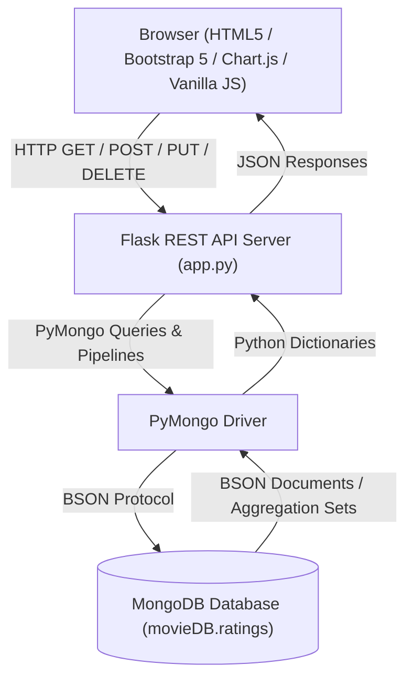

# College Project Report: Movie Rating Analysis and Genre Popularity Using MongoDB

**Academic Evaluation**: IA-2 Activity / Practical Based Learning  
**Project Title**: Movie Rating Analysis and Genre Popularity Using MongoDB  
**Technology Stack**: Python (Flask), PyMongo, MongoDB, HTML5, CSS3 (Vanilla Dark Mode), Bootstrap 5, Chart.js  

---

## 1. Abstract

In the modern digital streaming landscape, processing and analyzing massive volumes of user-generated ratings is fundamental to understanding audience preferences, discovering top-performing media, and identifying genre trends. This project presents a full-stack data analytics web application developed with **Flask**, **PyMongo**, and **MongoDB**. 

The system manages a collection of over 500 user movie rating documents in MongoDB (`movieDB.ratings`). Utilizing MongoDB's powerful Aggregation Framework, the application computes key metrics such as genre-wise popularity, release year trends, rating frequency distributions, and threshold-filtered movie rankings. The web frontend provides interactive visualizations powered by **Chart.js**, a searchable and filterable CRUD management table, and dynamically generated real-time insights derived from database queries.

---

## 2. Introduction

Movie rating platforms like IMDb, Rotten Tomatoes, and Letterboxd process millions of reviews daily. Relational databases often face performance bottlenecks when executing multi-stage analytics over large un-normalized review datasets. MongoDB, a NoSQL document-oriented database, stores data in flexible BSON documents and provides native aggregation pipelines that perform high-speed grouping, filtering, and sorting directly inside the database engine.

This project demonstrates the design and practical implementation of a movie rating analysis system. It serves as an educational showcase of MongoDB document modelling, index creation, CRUD operations, and advanced aggregation pipelines integrated into a responsive web application.

---

## 3. Problem Statement

Analyzing audience sentiment and genre performance across hundreds of movie titles requires:
1. Storing semi-structured rating data efficiently without rigid schema locks.
2. Preventing duplicate user reviews for identical movies.
3. Calculating statistical aggregations (averages, counts, distributions) without pulling all raw records into application memory.
4. Presenting complex analytical data in an accessible, interactive visual dashboard for academic evaluation and demonstration.

---

## 4. Objectives

- **Database Design**: Create a MongoDB database (`movieDB`) and collection (`ratings`) storing 500+ structured synthetic rating records.
- **Index Optimization**: Implement single-field indexes (`movie_title`, `genre`, `rating`) and a compound unique index on `(user_id, movie_title)` to prevent duplicate reviews.
- **CRUD Operations**: Build REST API endpoints in Flask to support Create, Read, Update, and Delete operations using PyMongo.
- **Aggregation Analytics**: Construct multi-stage MongoDB aggregation pipelines utilizing `$match`, `$group`, `$sort`, `$limit`, `$avg`, `$sum`, and `$addToSet`.
- **Interactive UI**: Develop a responsive, dark-mode cinema dashboard with Chart.js charts, searchable table pagination, and automated dynamic insights.

---

## 5. Software and Hardware Requirements

### Software Requirements
- **Operating System**: Windows 10/11, macOS, or Linux.
- **Programming Language**: Python 3.9+
- **Database**: MongoDB Server (v5.0+ local or MongoDB Atlas)
- **Backend Framework**: Flask 3.0+
- **Database Driver**: PyMongo 4.6+
- **Frontend Libraries**: Bootstrap 5.3, Chart.js 4.4, FontAwesome 6.4

### Hardware Requirements
- **Processor**: Intel Core i3 / AMD Ryzen 3 or higher.
- **RAM**: Minimum 4 GB (8 GB recommended).
- **Disk Space**: 500 MB free space for Python environment and MongoDB database files.

---

## 6. Technology Stack Architecture



---

## 7. Dataset Description and Collection Schema

The project includes a Python dataset generator script (`seed_data.py`) that populates MongoDB with **550 sample rating documents**.

### MongoDB Collection Schema (`ratings`)

```json
{
  "_id": ObjectId("65c8f1a2b3f4c5d6e7f8a9b0"),
  "user_id": "USER_124",
  "movie_title": "Interstellar",
  "genre": "Sci-Fi",
  "release_year": 2014,
  "rating": 4.5,
  "rating_date": "2024-03-15T14:30:00Z"
}
```

### Field Specifications
| Field Name | BSON Data Type | Description | Index Type |
| :--- | :--- | :--- | :--- |
| `_id` | `ObjectId` | Auto-generated Primary Key | Unique Default Index |
| `user_id` | `String` | Unique user identifier (e.g. `USER_101`) | Compound Index Part |
| `movie_title` | `String` | Title of the rated movie | Single Field Index + Compound |
| `genre` | `String` | Category (Action, Comedy, Drama, Sci-Fi, Romance, Horror, Animation, Thriller) | Single Field Index |
| `release_year` | `Int32` | Year movie was released (1888 - 2030) | Non-indexed |
| `rating` | `Double` | Rating value from 0.5 to 5.0 in 0.5 steps | Single Field Index |
| `rating_date` | `String` (ISO 8601) | Timestamp of review submission | Non-indexed |

---

## 8. Essential MongoDB Operations Implemented

The application demonstrates key MongoDB CRUD and query operations in PyMongo:

### 1. `insert_one()` / `insert_many()`
```python
# Inserting single document in POST /api/ratings
col.insert_one({
    "user_id": "USER_201",
    "movie_title": "Oppenheimer",
    "genre": "Drama",
    "release_year": 2023,
    "rating": 5.0,
    "rating_date": "2024-10-09T10:00:00Z"
})
```

### 2. `find()` and `count_documents()` with regex searching & pagination
```python
# Filtering, searching, sorting, and paginating
query = {"movie_title": {"$regex": "dark", "$options": "i"}, "genre": "Action"}
total = col.count_documents(query)
cursor = col.find(query).sort("rating", -1).skip(0).limit(10)
```

### 3. `update_one()`
```python
# Modifying rating document by ObjectId
col.update_one(
    {"_id": ObjectId(rating_id)},
    {"$set": {"rating": 4.5, "rating_date": "2024-10-09T10:15:00Z"}}
)
```

### 4. `delete_one()`
```python
# Deleting rating document
col.delete_one({"_id": ObjectId(rating_id)})
```

---

## 9. MongoDB Aggregation Pipelines Explained

MongoDB's `$aggregate()` method allows processing documents through a multi-stage pipeline.

### Pipeline 1: Top Rated Movies with Vote Count Threshold
Calculate top 10 movies by average rating, restricting results to movies with at least 5 reviews:

```python
pipeline = [
    # Stage 1: Group by movie_title and calculate average rating and review count
    {
        "$group": {
            "_id": "$movie_title",
            "avg_rating": {"$avg": "$rating"},
            "total_ratings": {"$sum": 1},
            "genre": {"$first": "$genre"},
            "release_year": {"$first": "$release_year"}
        }
    },
    # Stage 2: Match movies with at least 5 rating records
    {"$match": {"total_ratings": {"$gte": 5}}},
    # Stage 3: Sort by average rating descending, then review count descending
    {"$sort": {"avg_rating": -1, "total_ratings": -1}},
    # Stage 4: Limit output to top 10 documents
    {"$limit": 10}
]
```

### Pipeline 2: Genre Performance Analysis
Computes genre popularity, average rating, and distinct movie titles per genre:

```python
pipeline = [
    {
        "$group": {
            "_id": "$genre",
            "avg_rating": {"$avg": "$rating"},
            "total_ratings": {"$sum": 1},
            "distinct_movies_set": {"$addToSet": "$movie_title"}
        }
    },
    {
        "$project": {
            "genre": "$_id",
            "avg_rating": {"$round": ["$avg_rating", 2]},
            "total_ratings": 1,
            "distinct_movies_count": {"$size": "$distinct_movies_set"}
        }
    },
    {"$sort": {"avg_rating": -1}}
]
```

### Pipeline 3: Rating Distribution Breakdown (Histogram)
Groups documents by rating value (0.5 to 5.0) to count frequency:

```python
pipeline = [
    {"$group": {"_id": "$rating", "count": {"$sum": 1}}},
    {"$sort": {"_id": 1}}
]
```

---

## 10. Key Application Modules

1. **Dashboard (`/`)**: High-level executive overview featuring 4 KPI summary cards, Top 5 Movies Bar Chart, Genre Popularity Doughnut Chart, Rating Distribution Bar Chart, and dynamic query-driven insights.
2. **Ratings Data Table (`/ratings`)**: Full CRUD management interface with real-time title search, genre filtering, multi-field sorting, pagination, and modal dialogs for insertion, editing, and deletion.
3. **Deep Analysis Page (`/analysis`)**: Advanced analytical view featuring interactive vote threshold filters for top movies, review volume rankings, genre comparative dual-axis charts, release year trends, and live aggregation pipeline code blocks for viva examination.

---

## 11. Viva Questions and Answers (Faculty Evaluation Guide)

### Q1: What is MongoDB and how does it differ from traditional RDBMS?
**A**: MongoDB is a NoSQL document-oriented database that stores data in flexible, JSON-like BSON (Binary JSON) documents rather than rigid tables with fixed rows and columns. It offers dynamic schemas, native horizontal scalability (sharding), and high-performance aggregation pipelines.

### Q2: Why did we choose PyMongo for connecting Flask to MongoDB?
**A**: PyMongo is the official Python driver for MongoDB. It translates Python dictionaries directly to BSON documents, provides robust connection pooling, supports full aggregation pipeline execution, and handles thread-safe database operations natively.

### Q3: What is an Aggregation Pipeline in MongoDB?
**A**: An aggregation pipeline is a framework for data aggregation modeled on the concept of data processing pipelines. Documents pass through a multi-stage pipeline where each stage transforms the document set (e.g., `$match` filters, `$group` aggregates, `$sort` orders, `$limit` restricts output).

### Q4: How do `$group` and `$match` work in MongoDB aggregation?
**A**: `$match` filters documents so only those matching specified criteria pass to the next stage (equivalent to SQL `WHERE`). `$group` groups documents by a specified `_id` key and computes accumulated statistics like `$avg`, `$sum`, or `$min`/`$max` (equivalent to SQL `GROUP BY`).

### Q5: Why is a compound unique index placed on `(user_id, movie_title)`?
**A**: To enforce database-level data integrity. It guarantees that a specific user (`user_id`) can submit at most one rating document for a given `movie_title`, preventing duplicate review spam even if concurrent API calls occur.

### Q6: What is the difference between `$count` and `$sum: 1` in `$group`?
**A**: Inside a `$group` stage, `{"$sum": 1}` increments a counter by 1 for every document belonging to that group, effectively counting the group's total records. `$count` is a standalone pipeline stage introduced in MongoDB 3.4 to count all input documents passing through that stage.

### Q7: How does PyMongo handle MongoDB `ObjectId` serialization in Flask?
**A**: BSON `ObjectId` objects cannot be directly converted to standard JSON by Flask's `jsonify()`. We convert the `ObjectId` to a standard string (`str(doc["_id"])`) before sending API responses.

### Q8: What does `$addToSet` do in an aggregation pipeline?
**A**: `$addToSet` returns an array of all *unique* values that appear in the group for a specified field, eliminating duplicates (unlike `$push`, which retains all values).

### Q9: How does pagination work with PyMongo `find()`?
**A**: Pagination uses `.skip((page - 1) * limit)` to skip preceding records and `.limit(limit)` to fetch only the requested page size (e.g., 10 records).

### Q10: How do we prevent SQL/NoSQL injection in Flask and PyMongo?
**A**: By using PyMongo's structured query parameter dictionaries and validating data types (e.g., forcing integers and floats) before passing user input into MongoDB queries, preventing arbitrary operator injection.

---

## 12. Guide on Capturing Screenshots for Report Submission

To prepare screenshots of your running application for college project submission:

1. **Launch MongoDB & Flask Server**: Run `python app.py` in your terminal.
2. **Open Application in Browser**: Navigate to `http://127.0.0.1:5000/`.
3. **Capture Dashboard View**: Use `Windows Key + Shift + S` (Snipping Tool) to capture the executive dashboard with KPI cards and Chart.js charts. Save as `screenshot_dashboard.png`.
4. **Capture Ratings Table & CRUD Modal**: Navigate to `/ratings`, perform a search or open the "Add New Rating" modal, and capture the interface. Save as `screenshot_ratings.png`.
5. **Capture Deep Analysis View**: Navigate to `/analysis`, adjust the "Min Reviews" dropdown, and capture the threshold charts and aggregation reference box. Save as `screenshot_analysis.png`.

---

## 13. Conclusion and Future Enhancements

The **Movie Rating Analysis and Genre Popularity Using MongoDB** project successfully fulfills all academic criteria for practical database application development. By combining Flask, PyMongo, and MongoDB Aggregations, the application delivers real-time statistical metrics over 500+ records seamlessly.

### Future Enhancements
1. **User Authentication & Profiles**: Implement JWT or session-based login for personalized user watchlists.
2. **MongoDB Atlas Search**: Incorporate Lucene-powered fuzzy search for instant title lookups.
3. **Machine Learning Recommendations**: Implement collaborative filtering algorithms to recommend movies based on genre similarity and rating overlap.
